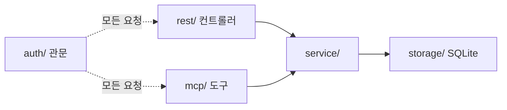

# 노션형-에디터-임베드 — moai-note-api 구현 플랜 (P)

## 헤더

- **요구사항**: 1030 — [./20260728-164655-1030_노션형-에디터-임베드_req.md](./20260728-164655-1030_노션형-에디터-임베드_req.md)
- **인터페이스 계약(I)**: [./20260728-164655-1030_노션형-에디터-임베드_interface-design.md](./20260728-164655-1030_노션형-에디터-임베드_interface-design.md) — 상태: 승인(2026-07-28)
- **모듈**: moai-note-api
- **작성일**: 2026-07-28 17:39:38
- **Goal**: 문서를 저장·조회·수정·삭제하고 리비전을 관리하는 API가 뜬다. REST와 MCP 두 표면으로 **동일 기능**을 제공하며, 둘 다 자체 발급 토큰으로 인증된다. `embed.js`도 이 서버가 제공한다.
- **Architecture**: 인증 관문 하나 → service 계층 하나 → storage 하나. REST 컨트롤러와 MCP 도구는 그 위의 얇은 어댑터다.



- **Tech Stack**: Node 20+ / TypeScript 5 / Fastify 5 / better-sqlite3 / jose(JWT) / @modelcontextprotocol/sdk / vitest
- **선행 P 의존성**: 없음. **이 P가 나머지 둘의 선행**이다 — API 계약이 서야 에디터·위젯 작업이 가능하다.

> 체크박스는 실행 가이드일 뿐, 진행 상태의 정본은 R의 상태 필드.

---

## 기술 선택 근거

| 선택 | 이유 |
|---|---|
| **Fastify** | 스키마 기반 검증(JSON Schema)이 내장이라 I의 DTO 계약을 코드로 강제하기 쉽다. https 기동·프록시 인식이 표준 지원 |
| **better-sqlite3** | 동기 API라 트랜잭션 코드가 단순하다. 리비전 저장은 "이전 내용 백업 + 본문 갱신"을 **한 트랜잭션**으로 묶어야 하는데 이 조합이 가장 안전 |
| **jose** | 표준 JWT 서명·검증. 자체 구현 금지 |
| **vitest** | TS 네이티브, 설정 부담 없음 |

---

## Task 1: 프로젝트 골격

**Files:**
- `moai-note-api/package.json`
- `moai-note-api/tsconfig.json`
- `moai-note-api/.env.example`
- `moai-note-api/.gitignore`
- `moai-note-api/src/config.ts`

**Steps:**

- [ ] Step 1.1: npm 프로젝트를 만들고 의존성을 설치한다.
  - Run: `cd moai-note-api && npm init -y && npm i fastify better-sqlite3 jose @modelcontextprotocol/sdk && npm i -D typescript tsx vitest @types/node @types/better-sqlite3`
  - Expected: `node_modules` 생성, `package.json`에 의존성 기록

- [ ] Step 1.2: `src/config.ts`에 환경변수를 한곳에서 읽는다. **비밀값에 기본값을 주지 않는다** — 없으면 기동 실패.

```ts
export interface Config {
  port: number;
  dbPath: string;
  tokenSecret: string;
  tokenTtlSeconds: number;
  corsOrigins: string[];
  tls?: { certPath: string; keyPath: string };
  maxContentBytes: number;
  maxRevisionsPerDocument: number;
}

function required(name: string): string {
  const v = process.env[name];
  if (!v) throw new Error(`환경변수 ${name} 가 필요합니다.`);
  return v;
}

export function loadConfig(): Config {
  const cert = process.env.MOAI_NOTE_TLS_CERT;
  const key = process.env.MOAI_NOTE_TLS_KEY;
  return {
    port: Number(process.env.MOAI_NOTE_PORT ?? 7100),
    dbPath: process.env.MOAI_NOTE_DB_PATH ?? './data/moai-note.db',
    // 서명키에 기본값을 주면 운영에 그대로 나갈 수 있다 — 반드시 주입받는다.
    tokenSecret: required('MOAI_NOTE_TOKEN_SECRET'),
    tokenTtlSeconds: Number(process.env.MOAI_NOTE_TOKEN_TTL ?? 3600),
    // 와일드카드 금지 (I §7)
    corsOrigins: (process.env.MOAI_NOTE_CORS_ORIGINS ?? '')
      .split(',').map((s) => s.trim()).filter(Boolean),
    tls: cert && key ? { certPath: cert, keyPath: key } : undefined,
    maxContentBytes: Number(process.env.MOAI_NOTE_MAX_CONTENT_BYTES ?? 1_000_000),
    maxRevisionsPerDocument: Number(process.env.MOAI_NOTE_MAX_REVISIONS ?? 50),
  };
}
```

- [ ] Step 1.3 (검증): 비밀값 없이 기동하면 실패한다
  - Run: `MOAI_NOTE_TOKEN_SECRET= npx tsx -e "import('./src/config.ts').then(m=>m.loadConfig())"`
  - Expected: `환경변수 MOAI_NOTE_TOKEN_SECRET 가 필요합니다.` 로 종료

---

## Task 2: 저장 계층 (SQLite)

**Files:**
- `moai-note-api/src/storage/schema.sql`
- `moai-note-api/src/storage/db.ts`
- `moai-note-api/src/storage/documentStore.ts`
- `moai-note-api/src/storage/clientStore.ts`

**Steps:**

- [ ] Step 2.1: `schema.sql`을 I §4 스키마 그대로 작성한다. `PRAGMA foreign_keys = ON`을 연결 시 적용한다(SQLite는 기본 off).
- [ ] Step 2.2: `db.ts`에서 DB를 열고 스키마를 멱등 적용한다(`CREATE TABLE IF NOT EXISTS`).
- [ ] Step 2.3: `documentStore.ts`에 CRUD + 리비전을 구현한다. **수정은 반드시 트랜잭션**이다.

```ts
// 수정: 이전 내용을 리비전으로 보존 + 본문 갱신을 한 트랜잭션으로 묶는다.
// 둘이 갈라지면 이력이 유실되거나 중복된다.
export function updateDocument(input: UpdateInput): Document {
  const tx = db.transaction((i: UpdateInput) => {
    const cur = selectForOwner(i.id, i.clientId, i.subject);
    if (!cur) return { kind: 'not_found' as const };
    if (cur.revision !== i.baseRevision) {
      return { kind: 'conflict' as const, currentRevision: cur.revision };
    }
    insertRevision(cur);                    // 직전 내용 보존
    const next = cur.revision + 1;
    updateRow(i, next);
    pruneRevisions(i.id, maxRevisions);     // 보관 상한
    return { kind: 'ok' as const, revision: next };
  });
  return tx(input);
}
```

- [ ] Step 2.4: **모든 조회·수정 쿼리에 `client_id`와 `subject` 조건을 넣는다.** 소유자 조건 없는 `SELECT ... WHERE id = ?`를 만들지 않는다 — 만드는 순간 인가 우회 경로가 된다.
- [ ] Step 2.5 (검증): 저장 계층 단위 테스트
  - Run: `npx vitest run src/storage`
  - Expected: 생성·조회·수정·삭제·리비전 보존·상한 정리·**다른 소유자 조회 시 미반환** 전부 통과

---

## Task 3: 인증 관문 (F-013)

**Files:**
- `moai-note-api/src/auth/token.ts`
- `moai-note-api/src/auth/guard.ts`
- `moai-note-api/src/auth/clientAdmin.ts`

**Steps:**

- [ ] Step 3.1: `token.ts` — 발급·검증. 토큰에는 `client_id`, `subject`, `subject_name`, `exp`만 담는다.
- [ ] Step 3.2: 클라이언트 시크릿은 **해시로 저장**하고 검증은 상수 시간 비교를 쓴다.

```ts
// 시크릿 평문 저장 금지. 비교는 타이밍 공격을 피해 상수 시간으로.
import { timingSafeEqual, scryptSync, randomBytes } from 'node:crypto';

export function hashSecret(secret: string, salt = randomBytes(16).toString('hex')): string {
  return `${salt}:${scryptSync(secret, salt, 64).toString('hex')}`;
}

export function verifySecret(secret: string, stored: string): boolean {
  const [salt, hash] = stored.split(':');
  if (!salt || !hash) return false;
  const a = Buffer.from(hash, 'hex');
  const b = scryptSync(secret, salt, 64);
  return a.length === b.length && timingSafeEqual(a, b);
}
```

- [ ] Step 3.3: `guard.ts` — Fastify `onRequest` 훅으로 **전역 등록**한다. 예외는 `/api/v1/auth/token`과 `/embed.js` **둘뿐**이며, 예외 목록을 한 곳에 상수로 두고 다른 곳에서 우회 등록하지 않는다.

```ts
// 인증 예외는 여기 두 개가 전부다. 라우트 파일에서 개별 우회 금지.
const PUBLIC_PATHS = new Set(['/api/v1/auth/token', '/embed.js']);

export function registerAuthGuard(app: FastifyInstance, cfg: Config) {
  app.addHook('onRequest', async (req, reply) => {
    if (PUBLIC_PATHS.has(req.routeOptions?.url ?? req.url.split('?')[0])) return;
    const header = req.headers.authorization;
    if (!header?.startsWith('Bearer ')) return unauthenticated(reply);
    try {
      req.principal = await verifyToken(header.slice(7), cfg);   // client_id + subject
    } catch {
      return unauthenticated(reply);
    }
  });
}
```

- [ ] Step 3.4: `clientAdmin.ts` — 클라이언트 등록·폐기 CLI. HTTP로 노출하지 않는다(등록 API 자체가 공격면이 된다).
  - `npm run client:add -- --name "SeedAI 챗봇" ` → `client_id` + `client_secret` 1회 출력
  - `npm run client:revoke -- --id <client_id>`
- [ ] Step 3.5 (검증): 인증 테스트
  - Run: `npx vitest run src/auth`
  - Expected: 토큰 없음 401 / 위조 401 / 만료 401 / 잘못된 시크릿 401 / 폐기된 클라이언트 401 통과

---

## Task 4: service 계층 (F-012·F-016)

**Files:**
- `moai-note-api/src/service/documentService.ts`
- `moai-note-api/src/service/errors.ts`

**Steps:**

- [ ] Step 4.1: `errors.ts`에 I §1.3의 오류 코드를 타입으로 정의한다.
- [ ] Step 4.2: `documentService.ts`에 **8개 기능의 유일한 구현**을 둔다 — create / list / get / update / delete / revisions / revisionGet / restore.
- [ ] Step 4.3: 모든 함수의 첫 인자를 `principal: { clientId, subject, subjectName }`로 통일한다. **호출자가 소유자를 지정할 수 없게** 시그니처로 막는다.
- [ ] Step 4.4: **다른 소유자의 문서는 `NOT_FOUND`로 반환**한다(I §1.3) — 존재 여부를 노출하지 않는다.
- [ ] Step 4.5: 본문 크기 상한을 service에서 검사한다(컨트롤러가 아니라) — MCP 경로에서도 동일하게 걸리도록.
- [ ] Step 4.6 (검증): service 테스트
  - Run: `npx vitest run src/service`
  - Expected: 8기능 정상 동작 + 충돌 409 + 남의 문서 404 + 크기 초과 400 통과

---

## Task 5: REST 표면 (F-012)

**Files:**
- `moai-note-api/src/rest/documentRoutes.ts`
- `moai-note-api/src/rest/authRoutes.ts`
- `moai-note-api/src/rest/schemas.ts`

**Steps:**

- [ ] Step 5.1: `schemas.ts`에 I §1.2 DTO를 JSON Schema로 정의하고 Fastify 라우트에 붙인다 — 검증을 코드로 강제한다.
- [ ] Step 5.2: 라우트는 **service 호출 + 오류 코드 → HTTP 매핑**만 한다. 라우트 안에 조건 분기 로직을 두지 않는다.
- [ ] Step 5.3: 목록 응답에서 `content`를 제외한다(I §1.2).
- [ ] Step 5.4: 오류 응답 형식을 I §1.3으로 통일한다.
- [ ] Step 5.5 (검증): REST 통합 테스트
  - Run: `npx vitest run src/rest`
  - Expected: 9개 엔드포인트 전부 계약대로 응답. 409에 `currentRevision` 포함

---

## Task 6: MCP 표면 (F-015)

**Files:**
- `moai-note-api/src/mcp/server.ts`
- `moai-note-api/src/mcp/tools.ts`

**Steps:**

- [ ] Step 6.1: `@modelcontextprotocol/sdk`의 streamable HTTP 전송으로 `/mcp`를 노출한다.
- [ ] Step 6.2: I §2.2의 8개 도구를 등록한다. 각 도구는 **`documentService`를 직접 호출**한다 — REST를 HTTP로 재호출하지 않는다.
- [ ] Step 6.3: 도구 설명에 I §2.3의 사용 지침을 넣는다 — 특히 `note_update`의 `baseRevision` 규약.
- [ ] Step 6.4: 요청의 `principal`을 인증 관문에서 받아 그대로 service에 넘긴다. MCP 파라미터로 소유자를 받지 않는다.
- [ ] Step 6.5 (검증): **REST↔MCP 동등성 테스트** — 같은 작업을 두 경로로 수행하고 결과를 비교한다.
  - Run: `npx vitest run src/mcp`
  - Expected: 8개 기능 모두 REST 결과와 일치. MCP 무인증 호출 401

---

## Task 7: HTTP 서버·TLS·CORS (F-014)

**Files:**
- `moai-note-api/src/http/server.ts`
- `moai-note-api/src/index.ts`

**Steps:**

- [ ] Step 7.1: TLS 설정이 있으면 https로, 없으면 http로 기동한다.

```ts
// 개발은 자체 서명 인증서, 운영은 프록시 종단 — 둘 다 지원한다.
const app = cfg.tls
  ? Fastify({ https: { cert: readFileSync(cfg.tls.certPath), key: readFileSync(cfg.tls.keyPath) },
              trustProxy: true })
  : Fastify({ trustProxy: true });   // X-Forwarded-Proto 인식
```

- [ ] Step 7.2: CORS를 **화이트리스트**로 등록한다. 목록이 비면 경고 로그를 남기고 **모든 크로스 오리진을 거부**한다(와일드카드로 폴백하지 않는다).
- [ ] Step 7.3: 요청 빈도 제한을 건다.
- [ ] Step 7.4: 인증 실패·권한 위반을 로그에 남기되 **토큰·시크릿 원문은 남기지 않는다**.
- [ ] Step 7.5 (검증):
  - Run: 자체 서명 인증서로 기동 후 `curl -k https://localhost:7100/api/v1/documents`
  - Expected: `401 UNAUTHENTICATED` (https 정상 기동 + 인증 동작)
- [ ] Step 7.6 (검증): 화이트리스트 밖 오리진 차단
  - Run: `curl -k -H "Origin: https://evil.example.com" -i https://localhost:7100/api/v1/documents`
  - Expected: 응답에 `Access-Control-Allow-Origin` 헤더 없음

---

## Task 8: embed.js 정적 제공 (F-010)

**Files:**
- `moai-note-api/src/http/staticRoutes.ts`

**Steps:**

- [ ] Step 8.1: `moai-note-editor-web/dist/embed.js`를 `/embed.js`로 제공한다. 경로는 설정으로 받는다.
- [ ] Step 8.2: 캐시 헤더를 둔다 — `Cache-Control: public, max-age=300, must-revalidate` + ETag. 갱신이 늦어도 5분 안에 반영되면서 매 요청 재다운로드하지 않는다.
- [ ] Step 8.3: 파일이 없으면 **404와 안내 로그**를 남긴다(에디터를 아직 빌드하지 않은 상태에서도 API는 떠야 한다).
- [ ] Step 8.4 (검증):
  - Run: `curl -k -I https://localhost:7100/embed.js`
  - Expected: 에디터 빌드 전 404 / 빌드 후 200 + `Cache-Control` 헤더

---

## 최종 검증

- [ ] Run: `npx vitest run`
- [ ] Expected: 전체 테스트 통과
- [ ] Run: `grep -rn "PUBLIC_PATHS" src/` 로 인증 예외 지점 확인
- [ ] Expected: `auth/guard.ts` **한 곳에서만** 정의·사용 (우회 등록 없음)
- [ ] Run: `grep -rn "SELECT" src/storage/ | grep -v "client_id"` 로 소유자 조건 누락 쿼리 확인
- [ ] Expected: 출력 0줄 (소유자 조건 없는 문서 조회 쿼리 없음)
- [ ] Run: MCP 클라이언트로 `/mcp` 연결 후 8개 도구 호출
- [ ] Expected: REST와 동일 결과, 무인증 시 401
- [ ] 완료 시 → 같은 디렉토리에 W 작성: `/dev artifact w --module=moai-note-api`
