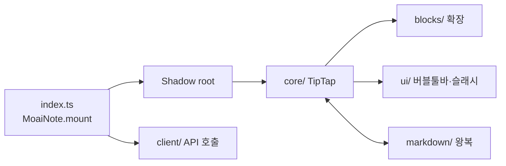

# 노션형-에디터-임베드 — moai-note-editor-web 구현 플랜 (P)

## 헤더

- **요구사항**: 1030 — [./20260728-164655-1030_노션형-에디터-임베드_req.md](./20260728-164655-1030_노션형-에디터-임베드_req.md)
- **인터페이스 계약(I)**: [./20260728-164655-1030_노션형-에디터-임베드_interface-design.md](./20260728-164655-1030_노션형-에디터-임베드_interface-design.md) — 상태: 승인(2026-07-28)
- **모듈**: moai-note-editor-web
- **작성일**: 2026-07-28 17:39:38
- **Goal**: `embed.js` 하나로 호스트 DOM에 노션형 에디터가 붙는다. `documentId`로 API에서 내용을 불러오고, 편집 결과를 저장한다. Shadow DOM으로 호스트와 스타일이 서로 격리된다.
- **Architecture**: TipTap 인스턴스를 Shadow root 안에 만들고, API 클라이언트가 문서를 오간다. 호스트가 보는 표면은 전역 `MoaiNote` 하나뿐이다.



- **Tech Stack**: TypeScript 5 / TipTap 2 (ProseMirror) / Vite 6 (라이브러리 모드) / vitest
- **선행 P 의존성**: [moai-note-api](./20260728-164655-1030_노션형-에디터-임베드-moai-note-api_dev-plan.md) — API가 떠 있어야 Task 7(연동) 검증이 가능하다. Task 1~6은 병행 가능.

> 체크박스는 실행 가이드일 뿐, 진행 상태의 정본은 R의 상태 필드.

---

## Task 1: 프로젝트 골격 및 빌드 (F-001)

**Files:**
- `moai-note-editor-web/package.json`
- `moai-note-editor-web/vite.config.ts`
- `moai-note-editor-web/tsconfig.json`
- `moai-note-editor-web/demo/index.html`

**Steps:**

- [ ] Step 1.1: 의존성 설치
  - Run: `cd moai-note-editor-web && npm init -y && npm i @tiptap/core @tiptap/starter-kit && npm i -D vite typescript vitest`
  - Expected: 설치 완료
- [ ] Step 1.2: Vite 라이브러리 모드로 **단일 파일** 산출. CSS는 별도 파일로 빼지 않고 **번들에 인라인**한다 — Shadow root에 주입해야 하므로 `<link>`로 붙일 수 없다.
- [ ] Step 1.3: `demo/index.html` — 백엔드 없이 에디터를 조작할 수 있는 개발 페이지. 로컬 상태로만 동작.
- [ ] Step 1.4 (검증): 빌드 산출
  - Run: `npm run build && ls -la dist/`
  - Expected: `dist/embed.js` 단일 파일 생성
- [ ] Step 1.5 (검증): 번들 용량 기록
  - Run: `du -h dist/embed.js`
  - Expected: 크기를 README에 기록 (지연 로드 판단 근거)

---

## Task 2: Shadow DOM 마운트와 임베드 계약 (F-007)

**Files:**
- `moai-note-editor-web/src/index.ts`
- `moai-note-editor-web/src/mount.ts`

**Steps:**

- [ ] Step 2.1: 전역에 `MoaiNote` **하나만** 노출한다. I §3.2 시그니처를 그대로 구현한다.
- [ ] Step 2.2: Shadow root를 만들고 스타일을 그 안에 주입한다.

```ts
// 호스트 CSS 전역 리셋(* { box-sizing; margin; padding })이 에디터 내부를 덮는 것을 막는다.
// 반대로 에디터 스타일이 호스트로 새는 것도 막힌다.
const host = document.createElement('div');
host.className = 'moai-note-host';
const shadow = host.attachShadow({ mode: 'open' });

const style = document.createElement('style');
style.textContent = EDITOR_CSS;      // 번들에 인라인된 CSS 문자열
shadow.appendChild(style);
```

- [ ] Step 2.3: `destroy()`에서 TipTap 인스턴스 파괴 + 전역 리스너 해제 + Shadow host 제거를 모두 수행한다.
- [ ] Step 2.4: 인스턴스별 상태를 클로저에 둔다 — 모듈 전역 변수를 쓰면 다중 인스턴스가 서로 간섭한다.
- [ ] Step 2.5 (검증): 누수 확인
  - Run: 데모 페이지에서 mount → destroy를 20회 반복하는 스크립트 실행
  - Expected: DOM 노드 수·리스너 수가 최초 상태로 복귀
- [ ] Step 2.6 (검증): 다중 인스턴스
  - Run: 데모 페이지에 3개를 동시에 마운트하고 각각 편집
  - Expected: 서로 내용·커서·툴바가 간섭하지 않음

---

## Task 3: 에디터 코어 (F-002)

**Files:**
- `moai-note-editor-web/src/core/editor.ts`
- `moai-note-editor-web/src/blocks/index.ts`

**Steps:**

- [ ] Step 3.1: 지원 블록을 확장으로 구성한다 — 문단, 제목 1~3, 순서 없는/있는 목록, 체크리스트, 인용, 코드블록, 표, 구분선.
- [ ] Step 3.2: 인라인 서식 — 굵게, 기울임, 취소선, 인라인 코드, 링크.
- [ ] Step 3.3: **붙여넣기 정규화** — 외부 HTML이 그대로 들어오지 않도록 지원 블록으로만 변환한다.
- [ ] Step 3.4 (검증): **한글 IME** — 최우선 항목
  - Run: 데모 페이지에서 한글 조합 중 ① 되돌리기(⌘Z) ② 굵게(⌘B) ③ 방향키 이동 ④ `/` 입력
  - Expected: 조합이 깨지지 않고, 커서가 튀지 않으며, 슬래시 메뉴가 오작동하지 않음
- [ ] Step 3.5 (검증): 붙여넣기
  - Run: 워드 문서·웹페이지·코드를 각각 복사해 붙여넣기
  - Expected: 지원 블록으로 정규화되며 임의 HTML/스타일이 유입되지 않음

---

## Task 4: 버블 툴바·슬래시 커맨드 (F-003·F-004)

**Files:**
- `moai-note-editor-web/src/ui/bubbleToolbar.ts`
- `moai-note-editor-web/src/ui/slashMenu.ts`

**Steps:**

- [ ] Step 4.1: 텍스트 선택 시 선택 영역 근처에 툴바를 띄운다 — 굵게 / 기울임 / 링크 / 블록 타입 전환.
- [ ] Step 4.2: 빈 줄에서 `/` 입력 시 블록 삽입 메뉴. 위/아래·Enter 선택, Esc 닫기.
- [ ] Step 4.3: **한글 조합 중에는 슬래시 메뉴를 열지 않는다** — `compositionstart`/`compositionend`로 판정한다.
- [ ] Step 4.4: 좁은 폭에서 툴바·메뉴가 컨테이너 밖으로 나가지 않도록 위치를 보정한다.
- [ ] Step 4.5 (검증):
  - Run: 데모를 320px 폭으로 좁혀 툴바·슬래시 메뉴 표시
  - Expected: 화면 밖으로 잘리지 않음

---

## Task 5: 마크다운 왕복 (F-005)

**Files:**
- `moai-note-editor-web/src/markdown/parse.ts`
- `moai-note-editor-web/src/markdown/serialize.ts`
- `moai-note-editor-web/test/roundtrip.test.ts`

**Steps:**

- [ ] Step 5.1: 마크다운 → 문서 모델 파서.
- [ ] Step 5.2: 문서 모델 → 마크다운 직렬화기.
- [ ] Step 5.3: **왕복 테스트를 자동화**한다 — 지원 문법별 케이스로 `parse(serialize(parse(md)))`가 안정적인지 확인.
- [ ] Step 5.4: 지원하지 않는 문법은 손실 없이 보존하거나, 불가피한 손실을 README에 문서화한다.
- [ ] Step 5.5 (검증):
  - Run: `npx vitest run test/roundtrip.test.ts`
  - Expected: 지원 문법 전 케이스 통과 (제목·목록·체크리스트·인용·코드·표·링크·인라인 서식)

---

## Task 6: 읽기/편집 모드·문서 액션·테마 (F-006·F-008·F-009)

**Files:**
- `moai-note-editor-web/src/ui/toolbar.ts`
- `moai-note-editor-web/src/theme.ts`

**Steps:**

- [ ] Step 6.1: 기본 읽기 전용. `Edit` 전환 시 편집 UI 노출.
- [ ] Step 6.2: 문서 액션 — 복사, 마크다운 내려받기, 전체화면.
- [ ] Step 6.3: 테마 — `light`/`dark`/`auto`. `auto`는 호스트 배경 밝기로 판정한다.
- [ ] Step 6.4: 색상을 CSS 변수로 Shadow host에 노출해 호스트가 덮어쓸 수 있게 한다(`--moai-note-` 접두사).
- [ ] Step 6.5 (검증):
  - Run: 데모에서 라이트/다크 전환, 읽기↔편집 전환, 3개 액션 실행
  - Expected: 전부 정상 동작

---

## Task 7: API 연동 (F-017)

**Files:**
- `moai-note-editor-web/src/client/api.ts`
- `moai-note-editor-web/src/client/saveController.ts`

**Steps:**

- [ ] Step 7.1: I §1의 REST 계약대로 클라이언트를 구현한다. `apiBase` 생략 시 `embed.js`를 받은 오리진을 쓴다.
- [ ] Step 7.2: 마운트 시 `documentId`로 내용을 불러온다. **호스트가 내용을 넘기지 않는다.**
- [ ] Step 7.3: 저장 시 `baseRevision`을 함께 보낸다. 응답의 `revision`으로 갱신한다.
- [ ] Step 7.4: **토큰 만료 처리** — 401 수신 시 `onTokenExpired`로 새 토큰을 받아 **같은 요청을 재시도**한다.

```ts
// 편집 중 토큰이 만료돼도 사용자의 입력이 사라져서는 안 된다.
async function request(path: string, init: RequestInit, retry = true): Promise<Response> {
  const res = await fetch(base + path, withAuth(init, token));
  if (res.status === 401 && retry && opts.onTokenExpired) {
    token = await opts.onTokenExpired();
    return request(path, init, false);   // 재시도는 1회
  }
  return res;
}
```

- [ ] Step 7.5: **409 충돌 처리** — 사용자에게 상황을 알리고 편집 내용을 화면에 유지한다. 조용히 덮어쓰지 않는다.
- [ ] Step 7.6: 저장 실패 시 `onError` 호출 + 내용 유지.
- [ ] Step 7.7 (검증): API 기동 상태에서 연동
  - Run: 데모에서 문서 불러오기 → 편집 → 저장 → 새로고침
  - Expected: 저장 내용이 유지됨
- [ ] Step 7.8 (검증): 충돌 시나리오
  - Run: 저장 직전에 다른 경로(curl 또는 MCP)로 같은 문서를 수정한 뒤 저장
  - Expected: 409 감지 → 사용자에게 알림 → **편집 내용이 사라지지 않음**
- [ ] Step 7.9 (검증): 서버 중단
  - Run: API를 내린 상태에서 편집·저장 시도
  - Expected: 저장 실패를 알리되 편집 자체는 계속 가능

---

## 최종 검증

- [ ] Run: `npx vitest run`
- [ ] Expected: 전체 통과 (특히 마크다운 왕복)
- [ ] Run: `npm run build && du -h dist/embed.js`
- [ ] Expected: 단일 파일 산출 + 용량 README 기록
- [ ] Run: 데모에서 한글 입력 시나리오(Task 3.4) 재확인
- [ ] Expected: 조합·되돌리기·서식·슬래시 모두 정상
- [ ] Run: mount/destroy 20회 반복
- [ ] Expected: DOM·리스너 누수 없음
- [ ] 완료 시 → 같은 디렉토리에 W 작성: `/dev artifact w --module=moai-note-editor-web`
