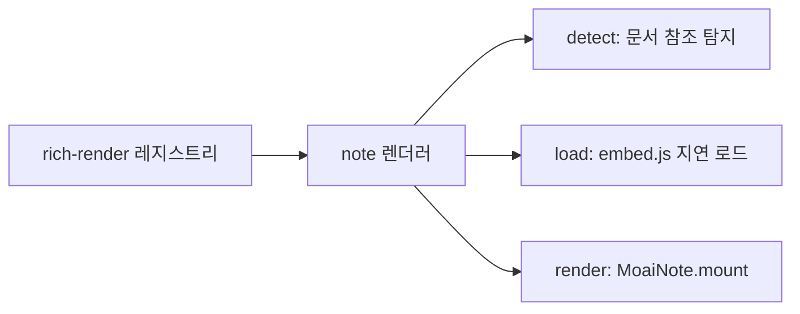

# 노션형-에디터-임베드 — seed-ai-agent-client-web-ui 구현 플랜 (P)

## 헤더

- **요구사항**: 1030 — [./20260728-164655-1030_노션형-에디터-임베드_req.md](./20260728-164655-1030_노션형-에디터-임베드_req.md)
- **인터페이스 계약(I)**: [./20260728-164655-1030_노션형-에디터-임베드_interface-design.md](./20260728-164655-1030_노션형-에디터-임베드_interface-design.md) — 상태: 승인(2026-07-28)
- **모듈**: seed-ai-agent-client-web-ui (**외부 저장소** — SeedAI)
- **작성일**: 2026-07-28 17:39:38
- **Goal**: 챗봇 위젯이 대화 안의 문서 참조를 감지해 `embed.js`를 지연 로드하고 에디터를 마운트한다. 문서 참조가 없는 대화에서는 추가 네트워크 요청이 발생하지 않는다.
- **Architecture**: R-1029의 렌더 레지스트리에 `note` 렌더러를 하나 추가하는 것이 전부다. 에디터 번들은 위젯에 들어가지 않는다.



- **Tech Stack**: Vanilla JS (위젯 규약), R-1029 렌더 레지스트리 `{ id, detect, load, render }`
- **선행 P 의존성**:
  - [moai-note-api](./20260728-164655-1030_노션형-에디터-임베드-moai-note-api_dev-plan.md) — `/embed.js` 제공과 토큰 발급이 필요
  - [moai-note-editor-web](./20260728-164655-1030_노션형-에디터-임베드-moai-note-editor-web_dev-plan.md) — `MoaiNote.mount` 계약 확정 필요

> 이 P는 **SeedAI 저장소를 수정**한다. moai-note 저장소가 아니다.
> 체크박스는 실행 가이드일 뿐, 진행 상태의 정본은 R의 상태 필드.

---

## 사전 확인 사항

| 항목 | 내용 |
|---|---|
| 렌더 레지스트리 | R-1029에서 만든 `core/rich-render.js` — `{ id, detect, load, render, streamSafe }` |
| 지연 로드 패턴 | `detect()`가 빈 배열이면 `load()`를 호출하지 않는다 → 요청 0건 |
| 새니타이저 | 위젯의 모든 HTML 주입은 DOMPurify를 거친다. **에디터 DOM은 이 경로를 타지 않아야 한다** |
| 사본 3벌 | User / Admin / SeedSiteKeeper — `sync-copies.sh` |
| 토큰 조달 | 위젯은 시크릿을 가질 수 없다. **호스트 백엔드가 발급한 단기 토큰**을 받아야 한다 |

---

## Task 1: 토큰 조달 경로 확정

**Files:**
- (조사 전용 — 코드 변경 없음)

**Steps:**

- [ ] Step 1.1: 위젯이 단기 토큰을 얻는 경로를 확정한다. 후보 두 가지:
  - (a) 호스트 백엔드에 신규 엔드포인트를 두고 위젯이 호출 → 백엔드가 moai-note에서 토큰을 받아 전달
  - (b) 에이전트가 문서 참조와 함께 토큰을 대화로 내려보냄
- [ ] Step 1.2: **(a)를 기본으로 한다** — (b)는 토큰이 대화 이력에 남아 만료 후에도 로그에 남는다.
- [ ] Step 1.3: 호스트 백엔드 작업이 필요하므로 **SeedAI 측 별도 요구사항이 필요한지 판단**한다. 필요하면 이 P를 진행하기 전에 R을 만든다.
  - Run: `grep -rn "seedai.upstreams\|routes" Seed_AI_User/seed-ai-user-backend/src/main/resources/application.yaml`
  - Expected: 기존 프록시 라우팅 구조를 확인하고, 신규 라우트 추가 가능 여부 판단
- [ ] Step 1.4 (검증): 결정 사항을 이 P의 헤더에 기록하고, 필요 시 SeedAI R 링크를 남긴다.

> **이 Task가 미해결이면 Task 3 이후를 진행할 수 없다.** 토큰 없이는 에디터가 문서를 불러오지 못한다.
>
> **관련 요구사항**: [R-1031 호스트 백엔드 클라이언트 SDK](./20260728-175241-1031_호스트-백엔드-클라이언트-SDK_req.md) —
> 호스트 백엔드가 moai-note-api에 인증하는 표준 수단을 SDK로 제공한다. 이 Task의 (a) 방안을 SDK가 담당한다.

---

## Task 2: 문서 참조 형식 확정

**Files:**
- `Seed_AI_Agent/seed-ai-agent-client-web-ui/core/renderers.js`

**Steps:**

- [ ] Step 2.1: 대화에 실을 문서 참조 형식을 정한다. 기존 위젯 관례가 두 가지다.
  - `[EMBED:NOTE:{documentId}]` — 기존 EMBED 마커 체계와 일관
  - ` ```note ` 코드펜스 — R-1029 리치 렌더 형식과 일관
- [ ] Step 2.2: **`[EMBED:NOTE:{documentId}]`를 택한다** — 문서 참조는 "임베드 대상"이지 "코드 형식"이 아니다. 기존 8종 마커와 성격이 같다.
- [ ] Step 2.3: `core/utils.js`의 EMBED 전처리에 슬롯 생성을 추가한다. **iframe 슬롯 선례와 동일한 패턴**을 쓴다(새니타이저가 커스텀 요소를 지우지 않도록 `data-*` 속성 사용).
- [ ] Step 2.4 (검증):
  - Run: 위젯 테스트 페이지에서 `[EMBED:NOTE:test-id]` 렌더
  - Expected: `data-moai-note-id="test-id"` 를 가진 슬롯 요소가 새니타이즈를 통과해 DOM에 남음

---

## Task 3: note 렌더러 등록 (F-011)

**Files:**
- `Seed_AI_Agent/seed-ai-agent-client-web-ui/core/renderers.js`

**Steps:**

- [ ] Step 3.1: 렌더 레지스트리에 `note` 렌더러를 등록한다.

```js
// 에디터 번들은 위젯에 들어가지 않는다. moai-note 서버에서 받는다.
const NOTE_EMBED_URL = (window.MOAI_NOTE_BASE || '') + '/embed.js';
const loadNoteEditor = RR.makeLoader([NOTE_EMBED_URL], function () { return !!window.MoaiNote; });

RR.register({
    id: 'note',
    streamSafe: false,
    detect: function (root) {
        // 문서 참조가 없으면 여기서 끝난다 — embed.js를 받지 않는다.
        return RR.selectUnrendered(root, '[data-moai-note-id]', 'note');
    },
    load: loadNoteEditor,
    render: function (slot) {
        const documentId = slot.getAttribute('data-moai-note-id');
        if (!documentId) return;
        return fetchNoteToken().then(function (token) {
            window.MoaiNote.mount(slot, {
                documentId: documentId,
                token: token,
                mode: 'read',
                theme: 'auto',
                onTokenExpired: fetchNoteToken
            });
        });
    }
});
```

- [ ] Step 3.2: `MOAI_NOTE_BASE`를 `core/chat-config.js`에서 설정한다 — **호스트별 설정이므로 동기화 대상이 아니다**.
- [ ] Step 3.3: 에디터 DOM이 위젯 새니타이즈 경로를 타지 않음을 확인한다(Shadow DOM 안에서 생성).
- [ ] Step 3.4 (검증): 지연 로드
  - Run: 개발자도구 Network 초기화 후 문서 참조가 **없는** 대화 렌더
  - Expected: `embed.js` 요청 **0건**
- [ ] Step 3.5 (검증): 마운트
  - Run: `[EMBED:NOTE:<실제 문서 id>]` 가 포함된 응답 렌더
  - Expected: `embed.js` 1회 로드 후 에디터가 표시되고 문서 내용이 보임

---

## Task 4: 폴백 처리

**Files:**
- `Seed_AI_Agent/seed-ai-agent-client-web-ui/core/renderers.js`

**Steps:**

- [ ] Step 4.1: `embed.js` 로드 실패 시 **문서 링크 카드**로 폴백한다. 대화가 깨지지 않아야 한다.
- [ ] Step 4.2: 토큰 조달 실패 시에도 동일하게 폴백한다.
- [ ] Step 4.3 (검증): 서버 차단
  - Run: moai-note 서버를 내린 상태에서 문서 참조가 포함된 대화 렌더
  - Expected: 링크 카드 표시, 콘솔 경고 1회, **대화의 다른 부분은 정상**

---

## Task 5: 스타일 격리 확인

**Files:**
- (검증 전용)

**Steps:**

- [ ] Step 5.1 (검증): 호스트 → 에디터 방향
  - Run: 위젯 CSS의 전역 리셋(`* { box-sizing; margin; padding }`)이 적용된 상태에서 에디터 표시
  - Expected: 에디터 내부 여백·크기가 데모 페이지와 동일 (Shadow DOM 차단 확인)
- [ ] Step 5.2 (검증): 에디터 → 호스트 방향
  - Run: 에디터 마운트 전후로 위젯 UI(메시지·툴바·입력창) 비교
  - Expected: 변화 없음
- [ ] Step 5.3 (검증): 다크 테마
  - Run: 위젯 다크 테마에서 에디터 표시
  - Expected: 에디터도 다크로 전환

---

## Task 6: 사본 동기화 및 문서 갱신

**Files:**
- `Seed_AI_Agent/seed-ai-agent-client-web-ui/` (원본)
- `SeedAI/docs/architecture/modules/seed-ai-agent-client-web-ui.md`

**Steps:**

- [ ] Step 6.1: 사본 동기화
  - Run: `./sync-copies.sh && ./sync-copies.sh --apply && ./sync-copies.sh`
  - Expected: 마지막 점검에서 **차이 0**
- [ ] Step 6.2: **에디터 번들이 사본에 들어가지 않았음**을 확인한다.
  - Run: `find <호스트>/public/moai -name "embed.js"`
  - Expected: 출력 0줄 — 번들은 moai-note 서버에만 있다
- [ ] Step 6.3: 모듈 문서에 `EMBED:NOTE` 마커와 note 렌더러를 반영한다.
- [ ] Step 6.4: SeedAI 포트 문서에 moai-note(7100)를 외부 의존으로 기록한다.

---

## 최종 검증

- [ ] Run: 개발자도구 Network — 문서 참조 없는 대화
- [ ] Expected: `embed.js` 요청 0건
- [ ] Run: 문서 참조 있는 대화 → 편집 → 저장
- [ ] Expected: 저장 후 새로고침해도 내용 유지
- [ ] Run: moai-note 서버 중단 상태에서 대화 렌더
- [ ] Expected: 링크 카드 폴백, 대화 정상
- [ ] Run: `./sync-copies.sh`
- [ ] Expected: 사본 3벌 차이 0
- [ ] Run: 기존 EMBED 8종 + R-1029 리치 렌더 형식 회귀 확인
- [ ] Expected: 무회귀
- [ ] 완료 시 → 같은 디렉토리에 W 작성: `/dev artifact w --module=seed-ai-agent-client-web-ui`
