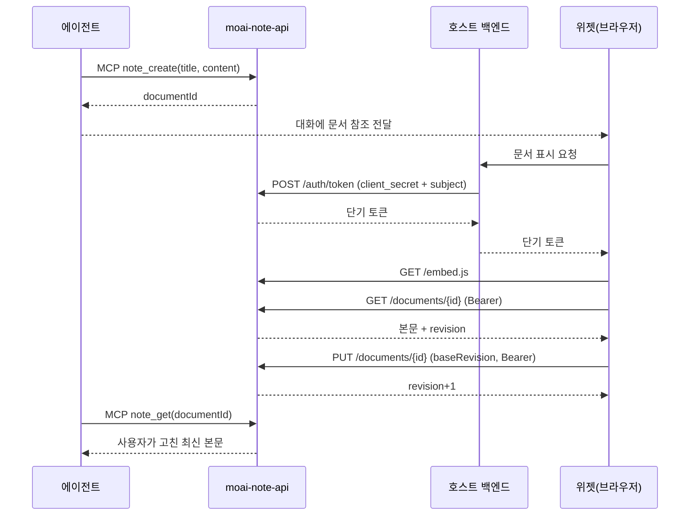
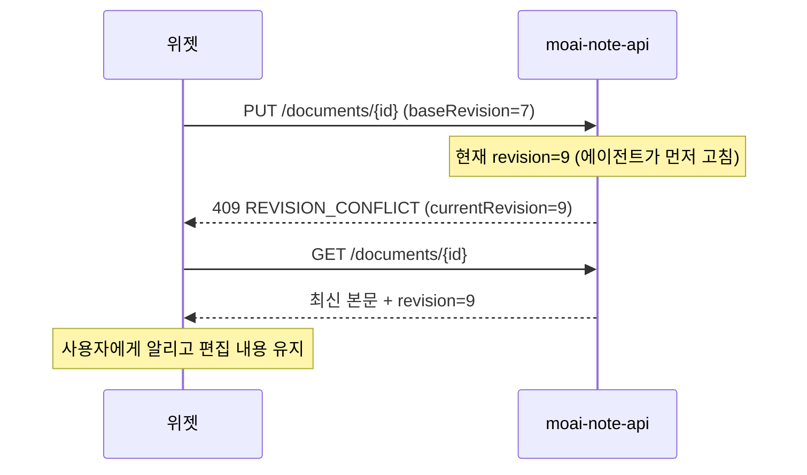

# 노션형-에디터-임베드 — 인터페이스 계약 (I)

## 메타데이터

- **요구사항**: 1030 — [./20260728-164655-1030_노션형-에디터-임베드_req.md](./20260728-164655-1030_노션형-에디터-임베드_req.md)
- **작성일**: 2026-07-28 17:36:43
- **상태**: 승인
  <!-- 허용값(enum): 초안 | 검토 | 승인 — 상태=승인 전 P 작성 금지 (DEV_PROCESS.md G2) -->
- **승인일**: 2026-07-28 (사용자 승인 — REST/MCP/임베드/스키마 4개 계약면 확정)
- **개정 이력**: (승인 후 변경 시 개정 행 추가 + 번복 대상 링크 필수)

> 표준: [DEV_PROCESS.md](../../DEV_PROCESS.md) §I — 다중 모듈이므로 필수.
> 이 문서가 확정하는 계약면은 넷이다: **① REST API ② MCP 도구 ③ 임베드(JS) ④ 저장 스키마**.

---

## 1. 모듈 간 API 계약

### 1.0 공통 규약

| 항목 | 값 |
|---|---|
| 베이스 URL | `https://<host>:7100` (기본 포트, `MOAI_NOTE_PORT`로 변경) |
| API 프리픽스 | `/api/v1` |
| 인증 | `Authorization: Bearer <액세스 토큰>` — **토큰 발급 엔드포인트를 제외한 전 경로** |
| 형식 | 요청·응답 모두 `application/json; charset=utf-8` |
| 시각 | ISO 8601 UTC (`2026-07-28T08:30:00Z`) |
| 식별자 | UUID v4 (추측 불가) |

### 1.1 엔드포인트

| 구분 | Method | Path | 설명 | 인증 |
|---|---|---|---|---|
| 토큰 | POST | `/api/v1/auth/token` | `client_secret` → 액세스 토큰 교환 | **클라이언트 자격증명** |
| 문서 | POST | `/api/v1/documents` | 문서 생성 | Bearer |
| 문서 | GET | `/api/v1/documents` | 목록 (소유자 기준) | Bearer |
| 문서 | GET | `/api/v1/documents/{id}` | 단건 조회 | Bearer |
| 문서 | PUT | `/api/v1/documents/{id}` | 수정 (본문·제목) | Bearer |
| 문서 | DELETE | `/api/v1/documents/{id}` | 삭제 | Bearer |
| 리비전 | GET | `/api/v1/documents/{id}/revisions` | 리비전 목록 | Bearer |
| 리비전 | GET | `/api/v1/documents/{id}/revisions/{rev}` | 리비전 내용 | Bearer |
| 리비전 | POST | `/api/v1/documents/{id}/revisions/{rev}/restore` | 해당 리비전으로 되돌리기 | Bearer |
| MCP | POST | `/mcp` | MCP streamable HTTP | Bearer |
| 정적 | GET | `/embed.js` | 에디터 번들 | **없음**(공개 자산) |

> `/embed.js`만 무인증이다. **스크립트 파일 자체에는 데이터가 없으며**, 실제 문서 접근은
> 전부 Bearer 토큰을 요구한다.

### 1.2 DTO

**토큰 발급** — `POST /api/v1/auth/token`

```json
// 요청 (서버 간 호출 전용 — 브라우저에서 호출 금지)
{
  "client_id": "seedai-chat-widget",
  "client_secret": "<시크릿>",
  "subject": "workspace-123:user-456",   // 호스트의 최종 사용자 식별자
  "subject_name": "임재키"                // 선택 — 리비전 표시용
}

// 응답
{
  "access_token": "<JWT>",
  "token_type": "Bearer",
  "expires_in": 3600
}
```

- `subject`는 **호스트가 정하는 불투명 문자열**이다. moai-note는 형식을 해석하지 않고 그대로 소유자 키로 쓴다.
- 같은 `client_id` + 같은 `subject` = 같은 소유자.

**문서** — 생성/수정/조회 공통 표현

```json
// 생성 요청 POST /api/v1/documents
{
  "title": "SF 시나리오 세계관",
  "content": "# 제목\n\n본문 마크다운…"
}

// 수정 요청 PUT /api/v1/documents/{id}
{
  "title": "SF 시나리오 세계관",
  "content": "# 제목\n\n고친 본문…",
  "baseRevision": 7          // 필수 — 충돌 감지용
}

// 응답 (단건)
{
  "id": "0a1b2c3d-…",
  "title": "SF 시나리오 세계관",
  "content": "# 제목\n\n본문 마크다운…",
  "revision": 8,
  "createdAt": "2026-07-28T08:00:00Z",
  "updatedAt": "2026-07-28T08:30:00Z",
  "updatedBy": "임재키"
}
```

- **본문 형식은 마크다운**이다. 저장 형식 = 교환 형식 = 에디터 입출력 형식.
- 목록 응답은 `content`를 **제외**한다(목록에서 전체 본문을 실어 나르지 않는다).

**리비전**

```json
// GET /api/v1/documents/{id}/revisions
{
  "items": [
    { "revision": 8, "updatedAt": "2026-07-28T08:30:00Z", "updatedBy": "임재키" },
    { "revision": 7, "updatedAt": "2026-07-28T08:10:00Z", "updatedBy": "agent:writer" }
  ]
}
```

### 1.3 에러 계약

```json
{ "error": { "code": "REVISION_CONFLICT", "message": "문서가 이미 변경되었습니다.", "currentRevision": 9 } }
```

| HTTP | code | 조건 |
|---|---|---|
| 400 | `INVALID_REQUEST` | 필수 필드 누락·형식 오류 |
| 400 | `CONTENT_TOO_LARGE` | 본문이 상한 초과 |
| 401 | `UNAUTHENTICATED` | 토큰 없음·위조·만료 |
| 401 | `INVALID_CLIENT` | 토큰 발급 시 `client_id`/`client_secret` 불일치 또는 폐기됨 |
| 403 | `FORBIDDEN` | 다른 소유자의 문서 접근 |
| 404 | `NOT_FOUND` | 문서·리비전 없음 |
| 409 | `REVISION_CONFLICT` | `baseRevision`이 현재 리비전과 불일치 |
| 429 | `RATE_LIMITED` | 요청 빈도 초과 |
| 500 | `INTERNAL_ERROR` | 서버 오류 (원인 상세를 응답에 노출하지 않음) |

> **403과 404의 구분**: 존재 여부를 노출하지 않기 위해, 다른 소유자의 문서는 **404로 응답**한다.
> `FORBIDDEN`은 소유자는 맞으나 작업이 금지된 경우에만 쓴다.

---

## 2. MCP 도구 계약

### 2.1 전송·인증

| 항목 | 값 |
|---|---|
| 경로 | `POST /mcp` |
| 전송 | streamable HTTP (`@modelcontextprotocol/sdk`) |
| 인증 | `Authorization: Bearer <액세스 토큰>` — **REST와 동일 관문** |

> **MCP만 무인증으로 여는 구성을 금지한다.** 인증 미들웨어는 `/mcp`를 포함한 전 경로에
> 등록되며, 라우트별 예외 목록에 `/mcp`를 넣지 않는다.

### 2.2 도구 목록

REST와 **기능 격차가 없어야 한다**. 각 도구는 대응 REST와 **같은 service 함수**를 호출한다.

| 도구 | 대응 REST | 설명 |
|---|---|---|
| `note_create` | `POST /documents` | 새 문서를 만든다. 제목과 마크다운 본문을 받는다 |
| `note_list` | `GET /documents` | 내 문서 목록을 조회한다(본문 제외) |
| `note_get` | `GET /documents/{id}` | 문서 본문을 마크다운으로 가져온다 |
| `note_update` | `PUT /documents/{id}` | 문서를 수정한다. `baseRevision` 필수 |
| `note_delete` | `DELETE /documents/{id}` | 문서를 삭제한다 |
| `note_revisions` | `GET /documents/{id}/revisions` | 변경 이력을 조회한다 |
| `note_revision_get` | `GET /documents/{id}/revisions/{rev}` | 특정 리비전 내용을 가져온다 |
| `note_restore` | `POST /documents/{id}/revisions/{rev}/restore` | 특정 리비전으로 되돌린다 |

### 2.3 도구 사용 지침 (설명 문구에 포함할 것)

- `note_update`는 **먼저 `note_get`으로 현재 `revision`을 확인**하고 그 값을 `baseRevision`으로 넘겨야 한다.
  409가 오면 다시 읽고 병합한 뒤 재시도한다. **덮어쓰기 위해 임의의 값을 넣지 말 것.**
- 본문은 **마크다운**이다. HTML을 넣지 않는다.
- 문서 전체를 다시 쓰는 방식이다(부분 패치 없음). 수정 시 **기존 본문을 읽어 반영한 전체 본문**을 보낸다.

---

## 3. 임베드 계약 (JS)

### 3.1 로드

```html
<script src="https://<moai-note>/embed.js"></script>
```

- **API 서버가 정적 제공**한다. 호스트에 번들을 복사하지 않는다.
- 로드되면 전역에 `MoaiNote` 하나만 노출한다. 다른 전역을 만들지 않는다.

### 3.2 공개 API

| 메서드 | 시그니처 | 설명 |
|---|---|---|
| `mount` | `MoaiNote.mount(target, options) → Instance` | 컨테이너에 에디터를 붙인다 |
| `version` | `MoaiNote.version → string` | 번들 버전(디버깅용) |

**options**

| 필드 | 필수 | 설명 |
|---|---|---|
| `documentId` | ✅ | 표시할 문서. **호스트가 내용을 넘기지 않는다** |
| `token` | ✅ | 단기 액세스 토큰 |
| `apiBase` | | API 베이스 URL. 생략 시 `embed.js`를 받은 오리진 |
| `mode` | | `'read'`(기본) \| `'edit'` |
| `theme` | | `'light'` \| `'dark'` \| `'auto'`(기본, 호스트 배경 밝기로 판정) |
| `onSave` | | `(doc) => void` — 저장 성공 시 |
| `onError` | | `(err) => void` — 로드·저장 실패 시 |
| `onTokenExpired` | | `() => Promise<string>` — 만료 시 새 토큰을 받아오는 훅 |

**Instance**

| 메서드 | 설명 |
|---|---|
| `destroy()` | DOM·이벤트·리스너를 모두 제거한다. 호출 후 잔존물이 없어야 한다 |
| `setMode(mode)` | 읽기/편집 전환 |
| `setToken(token)` | 토큰 갱신 |
| `getContent()` | 현재 마크다운 |

### 3.3 격리 규약

- 에디터 UI는 **Shadow root 안에서만** 생성한다.
  → 호스트 전역 리셋(`* { box-sizing; margin; padding }`)의 영향을 받지 않고, 호스트도 오염시키지 않는다.
- 호스트가 색을 덮어쓸 수 있도록 CSS 변수를 Shadow host에 노출한다(변수명은 구현 시 확정, `--moai-note-` 접두사).
- 전역 이벤트 리스너는 인스턴스당 등록·해제를 짝으로 맞춘다.

### 3.4 토큰 만료 처리

토큰이 만료되면 저장이 실패한다. **사용자 입력이 사라져서는 안 된다.**

1. 401 수신 → `onTokenExpired` 호출
2. 새 토큰을 받으면 **같은 저장 요청을 재시도**
3. 훅이 없거나 실패하면 `onError` 호출 + 편집 내용은 화면에 유지

---

## 4. 저장 스키마 (SQLite)

```sql
-- 클라이언트(호스트) 등록
CREATE TABLE client (
  client_id     TEXT PRIMARY KEY,
  secret_hash   TEXT NOT NULL,          -- 평문 저장 금지
  name          TEXT NOT NULL,
  revoked       INTEGER NOT NULL DEFAULT 0,
  created_at    TEXT NOT NULL
);

-- 문서
CREATE TABLE document (
  id            TEXT PRIMARY KEY,        -- UUID v4
  client_id     TEXT NOT NULL,
  subject       TEXT NOT NULL,           -- 호스트가 준 사용자 식별자
  title         TEXT NOT NULL,
  content       TEXT NOT NULL,           -- 마크다운
  revision      INTEGER NOT NULL DEFAULT 1,
  created_at    TEXT NOT NULL,
  updated_at    TEXT NOT NULL,
  updated_by    TEXT,
  FOREIGN KEY (client_id) REFERENCES client(client_id)
);

-- 소유자 조회가 가장 잦다
CREATE INDEX idx_document_owner ON document(client_id, subject, updated_at DESC);

-- 리비전 (수정 직전 내용을 보존)
CREATE TABLE document_revision (
  document_id   TEXT NOT NULL,
  revision      INTEGER NOT NULL,
  title         TEXT NOT NULL,
  content       TEXT NOT NULL,
  updated_at    TEXT NOT NULL,
  updated_by    TEXT,
  PRIMARY KEY (document_id, revision),
  FOREIGN KEY (document_id) REFERENCES document(id) ON DELETE CASCADE
);
```

**소유자 판정**: `(client_id, subject)` 조합이 소유자다. 두 값 모두 **토큰에서** 얻는다.
요청 본문·쿼리로 들어온 값은 쓰지 않는다.

**리비전 보관**: 문서당 최대 N개(설정, 기본 50). 초과분은 오래된 것부터 삭제한다.

---

## 5. 모듈 간 시퀀스

### 5.1 에이전트가 만들고 사람이 고치는 흐름



핵심은 마지막 두 단계다 — **에이전트와 사람이 같은 문서를 본다.**

### 5.2 저장 충돌



---

## 6. UI-UX

- **신규 화면 없음** — 호스트 안에 임베드된다.
- 읽기 모드는 호스트의 기존 마크다운 표시와 시각적으로 이질감이 없어야 한다.
- 편집 UI: 선택 시 버블 툴바, 빈 줄에서 `/` 슬래시 메뉴 (R F-003·F-004).
- 좁은 폭에서 툴바·메뉴가 컨테이너 밖으로 나가지 않는다.

---

## 7. 접근제어

**등록 대상 없음** — moai-note는 자체 인증 체계를 가지며 외부 접근제어 설정에 등록하지 않는다.

인증·인가 정책은 R 3.5가 정본이다. 요약하면:

- 전 경로 Bearer 필수 (`/auth/token`, `/embed.js` 제외)
- MCP도 동일 관문
- 소유권은 토큰의 `(client_id, subject)`로만 판정
- CORS 화이트리스트, 와일드카드 금지

---

## 8. Out of Scope

- 문서 공유·권한 위임 (소유자 본인 접근까지)
- 동시 편집(협업) — 충돌은 409로 감지만 한다
- 이미지 업로드·첨부
- PDF/docx 내보내기
- 폴더·태그 등 문서 조직화
- 전문 검색
- 리프레시 토큰 — 만료 시 호스트가 재발급한다(`onTokenExpired`)
